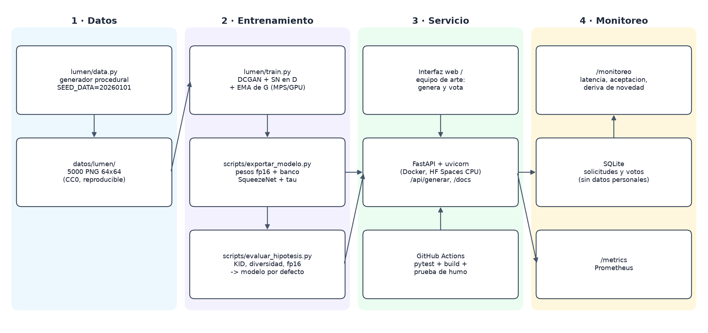
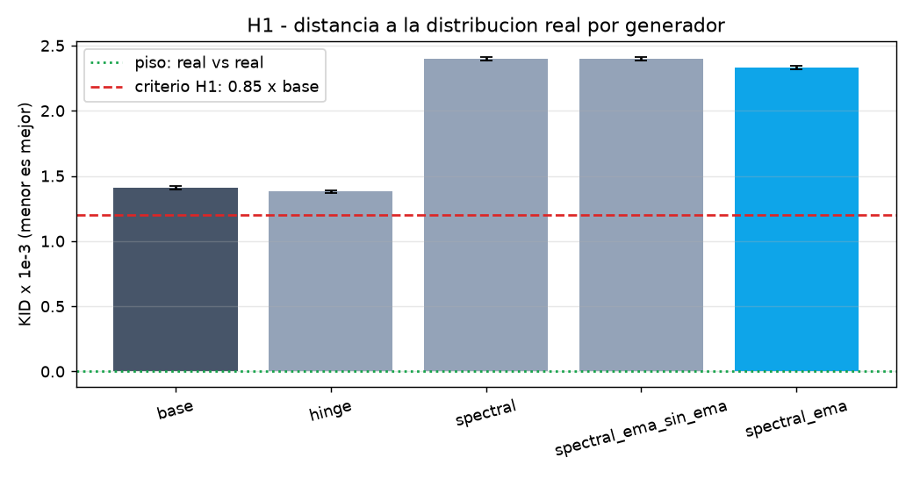
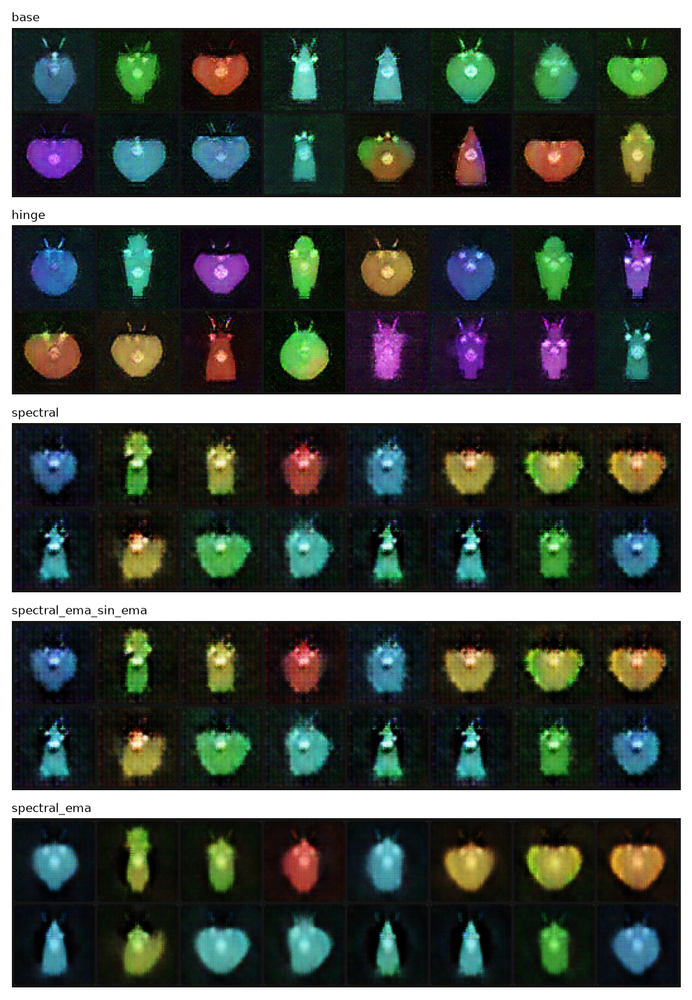
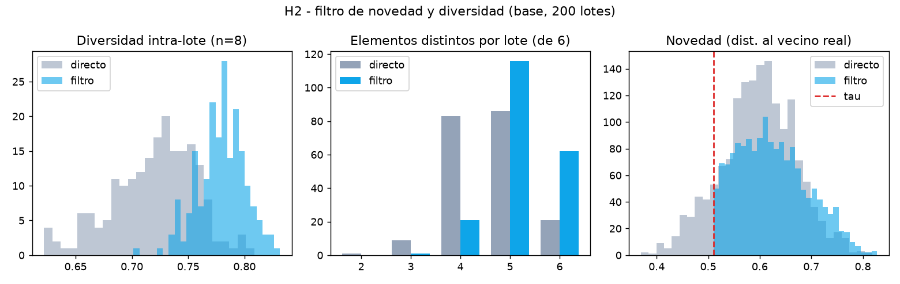
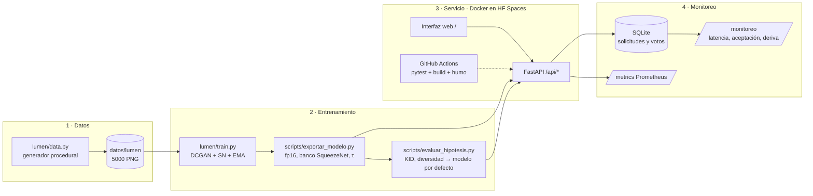
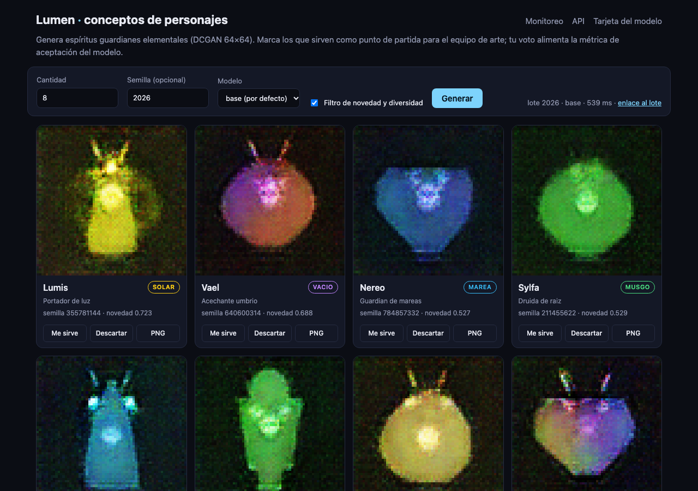
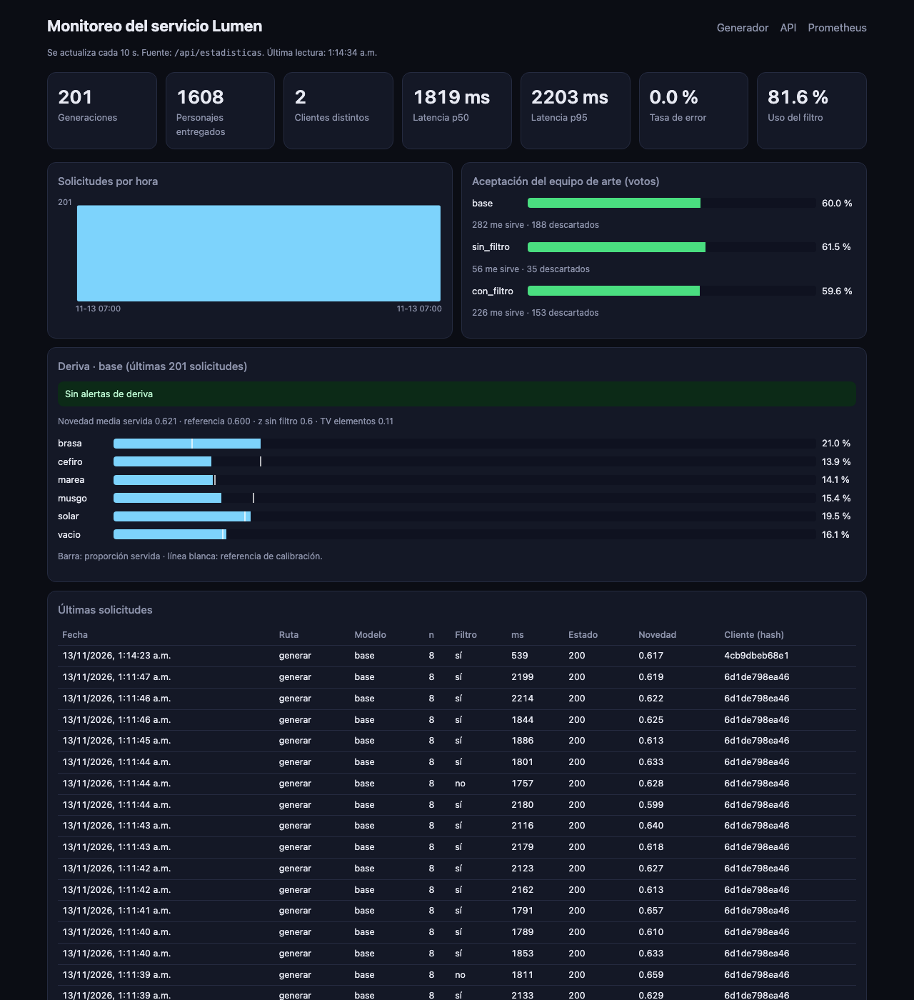
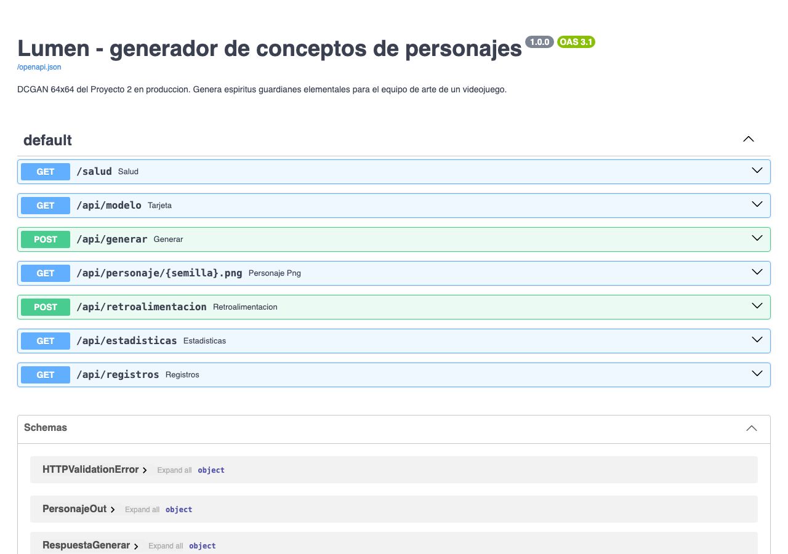

# Lumen en producción — generador de conceptos de personajes

Proyecto Final · Deep Learning y Sistemas Inteligentes · Universidad del Valle · 2026

**Integrantes:** Pablo Cabrera (231156) · Luis Pedro Lira · Mario Rocha

| | |
|---|---|
| **Servicio en producción** | [PENDIENTE_URL_SERVICIO](PENDIENTE_URL_SERVICIO) · interfaz en `/`, API en `/docs`, monitoreo en `/monitoreo` |
| **Repositorio** | <https://github.com/pablouwunya2021/deepproyecto-3> |
| **Modelo base** | Proyecto 2: DCGAN 64×64 «Lumen» (espíritus guardianes elementales) |
| **Presentación** | [`presentacion/presentacion.pdf`](presentacion/presentacion.pdf) · guion: [`presentacion/guion_presentacion.pdf`](presentacion/guion_presentacion.pdf) · guía de estudio: [`presentacion/guia_estudio.pdf`](presentacion/guia_estudio.pdf) |
| **Resultados** | [`docs/resultados.md`](docs/resultados.md) · criterios preregistrados en [`docs/hipotesis.md`](docs/hipotesis.md) |



---

## 1. Problemática

**Usuario.** El equipo de arte de un estudio indie que diseña los personajes del
videojuego *Lumen: Guardianes Elementales* (el universo del Proyecto 2).

**Problema.** Cada concepto inicial de un personaje toma horas de boceto. El equipo
necesita muchas ideas variadas para quedarse con unas pocas, y no quiere ideas que
sean copias de lo que ya tiene.

**Decisión que depende del modelo.**

- *Del usuario:* qué conceptos pasan a refinamiento. En la interfaz marca cada
  personaje como **«me sirve»** o **«descartar»**.
- *Del comité técnico y de negocio:* si el modelo **se mantiene en producción**. Se
  decide con la tasa de aceptación de esos votos, la novedad de lo servido (que no
  copie los datos), la latencia, la tasa de error y las alertas de deriva del tablero
  [`/monitoreo`](#7-evidencias-del-pase-a-producción).

**Fuera de alcance.** El modelo entrega bocetos de partida de 64×64 (escalados ×4
sin suavizado), no arte final.

## 2. Planificación

| # | Etapa | Fechas | Responsable | Entregable |
|---|---|---|---|---|
| 1 | Elección del modelo y alcance | 13 nov | Todos | Proyecto 2; usuario y decisión definidos |
| 2 | Portar el código y verificar reproducibilidad | 13 nov | Pablo Cabrera | `lumen/`; dataset idéntico byte a byte |
| 3 | Preregistro de hipótesis | 13 nov | Luis Pedro Lira | [`docs/hipotesis.md`](docs/hipotesis.md) |
| 4 | Entrenar la mejora (SN + EMA) | 13 nov | Pablo Cabrera | `G_spectral_ema` |
| 5 | Servicio, interfaz y monitoreo | 13 nov | Mario Rocha | `app/` |
| 6 | Pruebas, Docker y CI | 13 nov | Luis Pedro Lira | `tests/`, `Dockerfile`, `.github/workflows/ci.yml` |
| 7 | Evaluación de hipótesis y prueba de carga | 13 nov | Pablo Cabrera | [`docs/resultados.md`](docs/resultados.md) |
| 8 | Despliegue en Hugging Face Spaces | 14 nov | Mario Rocha | URL pública |
| 9 | Uso real y recolección de evidencias | 14–15 nov | Todos | registros, capturas |
| 10 | README y presentación final | 15 nov | Todos | este documento, `presentacion.pdf` |

## 3. Supuestos

**Datos**
- El dataset procedural del Proyecto 2 (5000 imágenes 64×64, CC0, `SEED_DATA = 20260101`)
  representa el estilo que quiere el equipo de arte. Se regenera **idéntico byte a byte**
  con `python -m lumen.data`, por eso no se versiona.
- La «novedad» de un personaje se mide como la distancia L2 a su vecino de
  entrenamiento más cercano en el espacio de SqueezeNet (ImageNet). Suponemos que en
  ese espacio «cerca» equivale a «visualmente parecido», como en la prueba de vecinos
  del Proyecto 2.
- La mezcla de elementos de las muestras de calibración es la referencia normal; un
  cambio grande indica deriva o colapso de modos.

**Usuario**
- Busca variedad e ideas de partida, no fidelidad; 64×64 le basta para decidir.
- Su voto «me sirve / descartar» es una señal honesta de utilidad.
- No necesita cuenta: el servicio es público y no guarda datos personales (el cliente
  se registra como hash truncado de IP + user-agent).

**Entorno**
- CPU compartida gratuita (Hugging Face Spaces, 2 vCPU, 16 GB) y tráfico bajo
  (decenas de solicitudes por hora). No hay GPU en inferencia.
- El disco del Space es efímero: SQLite se pierde al reiniciar. Los registros se
  exportan con `GET /api/registros` y se guardan en `evidencias/` (ver §7). Para
  operar a largo plazo habría que montar almacenamiento persistente.

## 4. Modelo planteado

**Proyecto de origen.** Proyecto 2 — DCGAN 64×64, desarrollado por Pablo Cabrera (integrante de este trío),
repositorio <https://github.com/pablouwunya2021/proyecto2-DL>. El código está portado
sin cambios funcionales al paquete [`lumen/`](lumen/).

**Arquitectura.**
- Generador: z ∈ ℝ¹²⁸ → 5 `ConvTranspose2d` (512→256→128→64→3 canales) con BatchNorm
  y ReLU → `tanh`, salida 3×64×64. 3.8 M parámetros.
- Discriminador: 5 `Conv2d` con stride 2, LeakyReLU(0.2).
- Adam (lr 2·10⁻⁴, β₁ 0.5), batch 128, 60 épocas, `SEED_TRAIN = 42`.

**Cambios justificados.**

| Cambio | Por qué |
|---|---|
| **Normalización espectral en D** *(no se adoptó: ver H1)* | En el Proyecto 2 (experimento B) llevó D(x) y D(G(z)) a 0.56 / 0.44, cerca del equilibrio, frente a 0.86 / 0.14 de la base. Un D que no domina debería dar mejor señal a G. |
| **EMA de los pesos de G** (decay 0.995) *(no se adoptó: ver H1)* | En una GAN, G oscila de un paso al siguiente. Servir el promedio exponencial de sus pesos es una técnica estándar (Karras et al., 2018; Yazıcı et al., 2019) para suavizar esa oscilación sin cambiar el entrenamiento. Con 2340 pasos, 0.995 olvida la inicialización (peso residual ≈ 10⁻⁵). |
| **Filtro de novedad y diversidad en el servicio** | Pedir 4n candidatos, descartar los de novedad < τ y elegir n por punto más lejano. Es la misma idea con la que se seleccionó la galería del Proyecto 2, ahora automática en cada solicitud. |
| **Pesos en fp16** | Bajan de 15.2 MB a 7.6 MB, por debajo del límite de 10 MB por archivo de Hugging Face sin Git LFS. Se ejecutan en fp32. |

**Reproducibilidad del cambio.** La corrida nueva (`python -m lumen.train --name spectral_ema --spectral-norm --ema-decay 0.995`)
reproduce **exactamente** las pérdidas del experimento `spectral` del Proyecto 2, época
por época (la EMA no toca el entrenamiento). Ver `evidencias/entrenamiento/spectral_ema/`.

## 5. Validación de hipótesis

Las tres hipótesis, sus métricas y sus criterios de éxito se registraron en
[`docs/hipotesis.md`](docs/hipotesis.md) **antes** de entrenar `spectral_ema` y antes de
calcular cualquier métrica. Los resultados completos están en
[`docs/resultados.md`](docs/resultados.md) (los genera `scripts/evaluar_hipotesis.py`).

**Protocolo común.** Características de SqueezeNet 1.1 (512 dims, L2). Se comparan
2000 muestras por generador (semilla 777) contra las 5000 imágenes reales con
**KID** (kernel polinomial cúbico; 10 subconjuntos de 1000; menor es mejor). La línea
base de producción es `base`, el generador con el que se armó la galería del Proyecto 2.

| Hipótesis | Métrica y criterio previo | Línea base | Resultado | Veredicto |
|---|---|---|---|---|
| **H1** SN + EMA mejora el modelo | KID(`spectral_ema`) ≤ 0.85 × KID(`base`) | KID `base` = 1.41×10⁻³ | KID `spectral_ema` = 2.33×10⁻³ (×1.65) | ❌ no cumple |
| **H2** el filtro da lotes más diversos | diversidad ≥ ×1.10, cobertura ≥ base, KID ≤ ×1.25 | muestreo directo: diversidad 0.720, 4.58 elementos/lote | diversidad ×1.082, 5.20 elementos/lote, KID ×1.02 | ❌ no cumple (por diversidad) |
| **H3** fp16 y latencia en CPU | dif. píxel < 1/255, mismo elemento ≥ 99 %, p95 < 1.5 s con 4 clientes | pesos fp32 | dif. 0.010/255, 99.6 % igual; p95 = 2.2 s | ❌ no cumple (por latencia) |

**Interpretación.**

- **H1, el modelo nuevo es peor.** La normalización espectral equilibró el juego
  adversarial (D(x) ≈ 0.56), pero las muestras quedaron más ruidosas: KID
  `spectral` = 2.40×10⁻³ contra 1.41×10⁻³ de `base`.
  La EMA sí ayuda, aunque poco: baja el KID un 3 %
  frente al mismo G sin EMA (control aislado, idéntico bit a bit a `spectral` del P2),
  porque suaviza el ruido. No alcanza para superar a `base`.
  Que un discriminador «equilibrado» no implique mejores muestras corrige la
  conclusión del experimento B del Proyecto 2.
  **Decisión preregistrada: el servicio sigue usando `base` por defecto.**
  `spectral_ema` se sirve como alternativa para compararlo con votos reales.
  (Observación no preregistrada: `hinge` tiene KID 1.38×10⁻³,
  un 2 % mejor que `base`. Es candidato para una próxima hipótesis, no una conclusión.)
- **H2, el filtro no llega al umbral de diversidad, pero no estorba.** La diversidad
  sube ×1.08 (se pedía ×1.10). La cobertura sí mejora, de
  4.58 a 5.20 elementos distintos por lote de 8,
  y el KID no se mueve (×1.02). El filtro queda **activado por defecto
  pero opcional**. Como el criterio no se cumplió, cada voto registra si el lote venía
  con o sin filtro, y con esa comparación A/B el comité decide si se mantiene.
- **H3, fp16 sí; latencia con concurrencia no.** fp16 no cambia las salidas de forma
  apreciable (0.01/255 de diferencia media) y deja los pesos en 7.6 MB. Con un solo
  cliente el p95 es **579 ms**. Con 4 clientes simultáneos y
  2 CPU el servicio queda limitado por cómputo: la primera versión dio p95 =
  3.0 s. Serializar la inferencia con un candado eliminó
  la competencia entre hilos y subió el rendimiento de 1.58 a 2.09
  sol/s, pero el p95 quedó en **2.2 s**. Para el tráfico
  supuesto (decenas de solicitudes por hora) alcanza. Para más carga harían falta más
  CPU o bajar los candidatos del filtro de 4n a 2n.

Tablas completas, figuras y las tres mediciones de latencia: [`docs/resultados.md`](docs/resultados.md).





## 6. Herramientas y arquitectura



| Capa | Herramienta | Por qué |
|---|---|---|
| Modelo | PyTorch 2.13 | Lo usamos en el Proyecto 2; la inferencia en CPU tarda milisegundos por imagen. |
| Servicio | FastAPI + uvicorn | Valida las entradas con Pydantic y genera la documentación OpenAPI en `/docs`, así un tercero puede usar la API sin leer el código. |
| Interfaz | HTML + JS sin dependencias | Una sola página servida por la misma API; no hace falta un build de frontend. |
| Empaquetado | Docker (`python:3.12-slim`, torch CPU) | La misma imagen corre local, en CI y en el Space. Los pesos de SqueezeNet quedan dentro de la imagen, así que el arranque no depende de internet. |
| Hosting | Hugging Face Spaces (SDK Docker, CPU gratis) | Es gratis, da URL pública con HTTPS y aguanta torch en memoria (16 GB). |
| CI | GitHub Actions | Pruebas en cada push, construcción de la imagen y prueba de humo del contenedor. |
| Registro | SQLite | Sin servidor externo. Cada solicitud y cada voto queda como fila consultable. |
| Monitoreo | Tablero `/monitoreo` + `/metrics` (Prometheus) | KPIs, aceptación por modelo y deriva (z-score de la novedad, distancia de variación total de la mezcla de elementos). |

**Endpoints**

| Método y ruta | Descripción |
|---|---|
| `GET /` | Interfaz: generar, revisar, votar y descargar personajes. `/?semilla=123` reproduce un lote. |
| `POST /api/generar` | `{"n": 8, "semilla": 123, "filtro": true, "modelo": "base", "tam": 256}` → personajes con PNG en base64. |
| `GET /api/personaje/{semilla}.png` | Regenera un personaje exacto (`?modelo=`, `?tam=`). |
| `POST /api/retroalimentacion` | `{"semilla": 1, "modelo": "base", "voto": "me_sirve", "filtro": true}` |
| `GET /api/estadisticas` | Uso, latencia p50/p95, error, aceptación y deriva. |
| `GET /api/registros` | Últimas solicitudes y votos (para exportar evidencias). |
| `GET /api/modelo` | Tarjeta del modelo (τ, referencias, decisión de H1, hashes). |
| `GET /salud`, `GET /metrics`, `GET /docs` | Vida, Prometheus, OpenAPI. |

**Monitoreo y alertas.** Para cada modelo, en las últimas 500 solicitudes:

- **Deriva de novedad:** solo en solicitudes sin filtro, porque el filtro sube la
  novedad a propósito. z = (media servida − media de calibración) / error estándar.
  Hay alerta si |z| > 3. Una caída indica que el modelo empezó a copiar datos o a
  colapsar.
- **Deriva de la mezcla de elementos:** distancia de variación total frente a la
  calibración. Hay alerta si es > 0.25 con al menos 50 personajes.
- **Negocio:** tasa de aceptación = me sirve / (me sirve + descartar), por modelo y con o sin filtro (comparación A/B que decide el filtro, ver H2).

## 7. Evidencias del pase a producción

**Enlace al servicio:** [PENDIENTE_URL_SERVICIO](PENDIENTE_URL_SERVICIO) (Hugging Face Spaces, Docker, CPU).

| Interfaz (`/?n=8&semilla=2026`) | Tablero de monitoreo (`/monitoreo`) |
|---|---|
|  |  |

Documentación interactiva de la API (`/docs`): 

**Pruebas.**

- `pytest`: 16 pruebas de la API y del modelo. Cubren determinismo por semilla,
  respeto de τ y ausencia de repetidos en el filtro, independencia del lote, validación
  de entradas (422), registro, métricas, que no se guarden IP y la carga de los pesos
  fp16. Corren en GitHub Actions en cada push
  ([`.github/workflows/ci.yml`](.github/workflows/ci.yml)).
- La CI también construye la imagen Docker y hace una prueba de humo del contenedor
  (`/salud` y `/api/generar`). Esa prueba encontró un error real: `lumen/utils.py`
  importaba matplotlib al cargar el módulo y la imagen de producción no lo trae. Se
  corrigió con un import diferido.
- **Prueba de carga** sobre el contenedor limitado a 2 CPU
  ([`scripts/prueba_carga.py`](scripts/prueba_carga.py)): 200 solicitudes,
  4 clientes, **0 errores**, 2.09 sol/s,
  p50 1861 ms, p95 2216 ms
  ([`evidencias/prueba_carga.json`](evidencias/prueba_carga.json)). La imagen usa
  ≈330 MB de RAM.

**Registros de uso.** Cada solicitud y cada voto queda en SQLite y se exporta con
`GET /api/registros`. El extracto de la prueba local está en
[`evidencias/registros/`](evidencias/registros/): 201 generaciones,
1608 personajes, tasa de error 0.0 %, sin
alertas de deriva (z de novedad sin filtro = 0.62,
TV de elementos = 0.11). *Los votos de
esa prueba los genera una regla simulada del script de carga; no son de usuarios.*
Los registros de uso real del Space se agregan en `evidencias/registros/` antes de
la entrega (PENDIENTE_REGISTROS_PRODUCCION).

---

## Estructura del repositorio

```
app/                    servicio: main.py (FastAPI), monitoreo.py (SQLite), static/ (interfaz y tablero)
lumen/                  código del Proyecto 2 (modelo, datos, entrenamiento) + inferencia.py
modelos/                pesos fp16 servidos, banco de características y tarjeta_modelo.json
scripts/                exportar_modelo, evaluar_hipotesis, prueba_carga, publicar_hf,
                        diagrama_arquitectura, generar_presentacion, capturas
tests/                  pruebas de la API y del modelo (pytest)
docs/                   hipotesis.md (preregistro) y resultados.md
evidencias/             entrenamiento, hipótesis, prueba de carga, capturas y registros de uso
presentacion/           presentacion.pdf
Dockerfile, .github/workflows/ci.yml, requirements*.txt
```

## Instrucciones de ejecución

Requiere Python 3.12+ (probado en 3.12 en Docker/CI y en 3.14 en macOS).

### Usar el servicio local

```bash
pip install -r requirements-dev.txt
uvicorn app.main:app --port 7860          # http://127.0.0.1:7860
```

o con Docker:

```bash
docker build -t lumen .
docker run -p 7860:7860 lumen
```

### Pruebas

```bash
pytest -v
```

### Reproducir todo desde cero

```bash
python -m lumen.data                                                  # 1. dataset (idéntico al P2)
python -m lumen.train --name base                                     # 2. línea base (o copiar G_base.pt del P2)
python -m lumen.train --name hinge --loss hinge                       #    experimentos del P2 (opcionales)
python -m lumen.train --name spectral --spectral-norm
python -m lumen.train --name spectral_ema --spectral-norm --ema-decay 0.995   # modelo nuevo (~20 min en MPS)
python scripts/exportar_modelo.py                                     # 3. fp16, banco de características, τ
uvicorn app.main:app --port 7860 &                                    # 4. servicio
python scripts/prueba_carga.py --solicitudes 200 --clientes 4         # 5. latencia (H3)
python scripts/evaluar_hipotesis.py                                   # 6. H1-H3 → docs/resultados.md
python scripts/diagrama_arquitectura.py && python scripts/generar_presentacion.py
```

Los checkpoints fp32 de `base`, `hinge` y `spectral` son los del repositorio del
Proyecto 2 (`checkpoints/`); con las mismas semillas, reentrenarlos da los mismos pesos.

### Desplegar en Hugging Face Spaces

```bash
pip install -U huggingface_hub
hf auth login                                   # token con permiso de escritura
scripts/publicar_hf.sh <usuario_hf>/lumen       # crea/actualiza el Space (SDK Docker)
```

## Uso de inteligencia artificial

Usamos un asistente de IA (Claude) como apoyo para programar. Nos ayudó a:

- portar el código del Proyecto 2 a un paquete;
- escribir el servicio FastAPI, la interfaz, el tablero de monitoreo, las pruebas, el
  Dockerfile, la CI y los scripts de evaluación, carga y presentación;
- redactar este documento.

El equipo eligió el problema y el usuario, definió las hipótesis y sus criterios antes
de entrenar, revisó el código, interpretó los resultados y tomó la decisión de qué
modelo servir. Cada integrante puede explicar cualquier parte del código. El modelo
servido no llama a ninguna API externa: todas las imágenes las produce el generador
entrenado en este repositorio.
