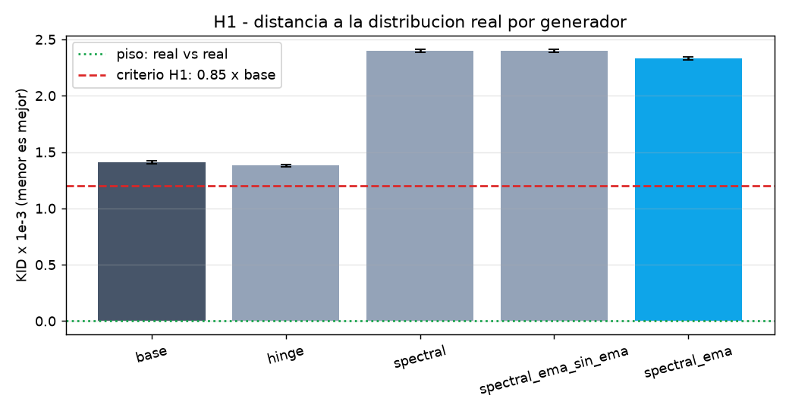
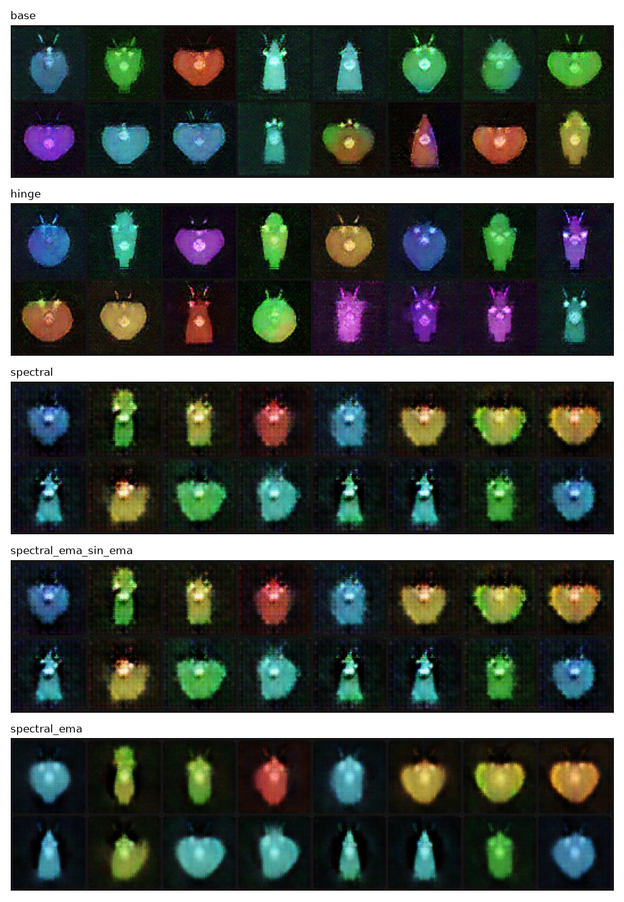
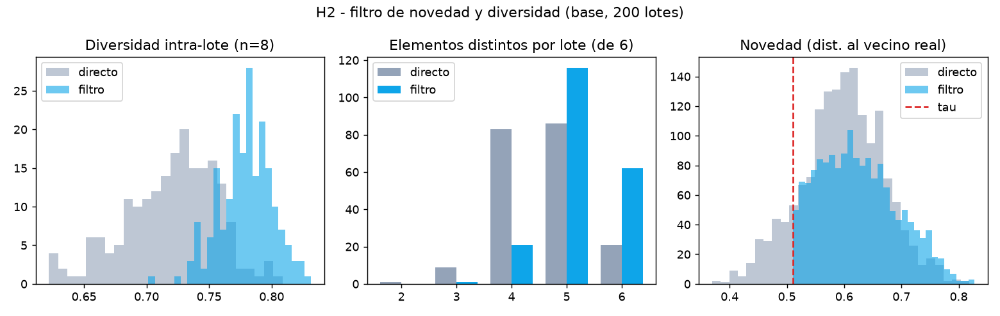

# Resultados de las hipótesis

> Generado por `scripts/evaluar_hipotesis.py` el 2026-11-13T01:12:01. Criterios en
> [`hipotesis.md`](hipotesis.md) (registrados antes de entrenar). Números completos en
> `evidencias/hipotesis/resultados.json`.

## H1 — normalización espectral + EMA vs línea base · ❌ no cumple

| Generador | KID × 10⁻³ (media ± desv.) | relativo a `base` |
|---|---|---|
| `base` | 1.411 ± 0.014 | 1.00 |
| `hinge` | 1.380 ± 0.012 | 0.98 |
| `spectral` | 2.397 ± 0.014 | 1.70 |
| `spectral_ema_sin_ema` | 2.397 ± 0.014 | 1.70 |
| `spectral_ema` | 2.330 ± 0.014 | 1.65 |
| *piso: real vs real* | -0.000 | — |

Razón `spectral_ema / base` = **1.651** (criterio ≤ 0.85).
Decisión: el servicio usa **`base`** por defecto.

## H2 — filtro de novedad y diversidad (modelo `base`) · ❌ no cumple

| Métrica | Directo (línea base) | Con filtro | Criterio |
|---|---|---|---|
| Diversidad intra-lote | 0.7201 | 0.7794 (×1.082) | ≥ ×1.10 |
| Elementos distintos por lote | 4.58 | 5.20 | ≥ directo |
| KID × 10⁻³ | 1.381 | 1.402 (×1.015) | ≤ ×1.25 |
| Novedad media | 0.5969 | 0.6247 | — |

## H3 — pesos fp16 y latencia en CPU · ❌ no cumple

| Métrica | Valor | Criterio |
|---|---|---|
| Diferencia media de píxel fp32 vs fp16 | 0.0104 / 255 | < 1 / 255 |
| Diferencia máxima de píxel | 0.521 / 255 | — |
| Mismo elemento asignado (500 muestras) | 99.6 % | ≥ 99 % |
| Tamaño del archivo de pesos | 15.2 MB → 7.6 MB | < 10 MB |
| Latencia p95 `POST /api/generar` (n=8, filtro, 4 clientes) | 2216 ms | < 1500 ms |

Mediciones de latencia en el contenedor Docker limitado a 2 CPU (como HF Spaces gratis):

| Medición | Clientes | p50 | p95 | Rendimiento | Errores |
|---|---|---|---|---|---|
| v1: inferencias en paralelo | 4 | 2777 ms | 3014 ms | 1.58 sol/s | 0/200 |
| v2: inferencia serializada (candado) | 4 | 1861 ms | 2216 ms | 2.09 sol/s | 0/200 |
| v2: un solo cliente | 1 | 519 ms | 579 ms | 2.09 sol/s | 0/60 |
